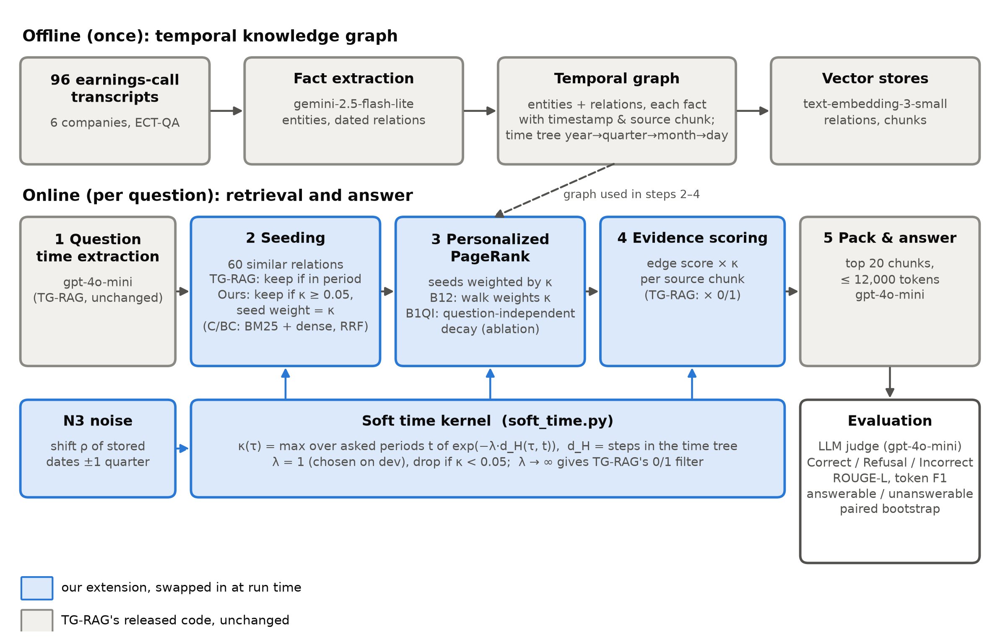
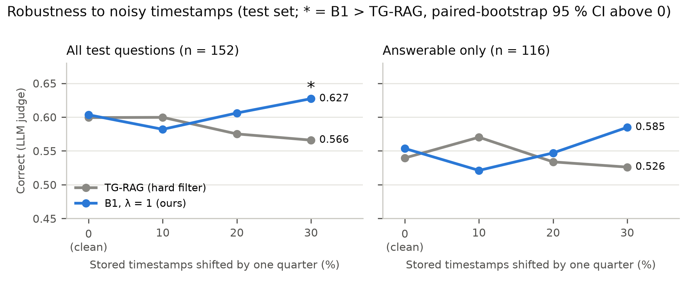
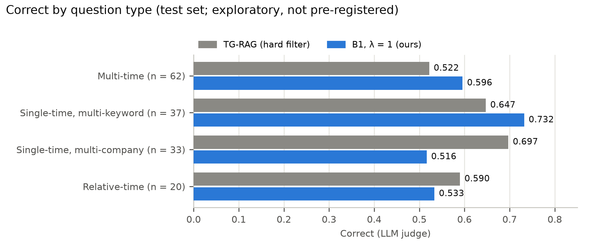
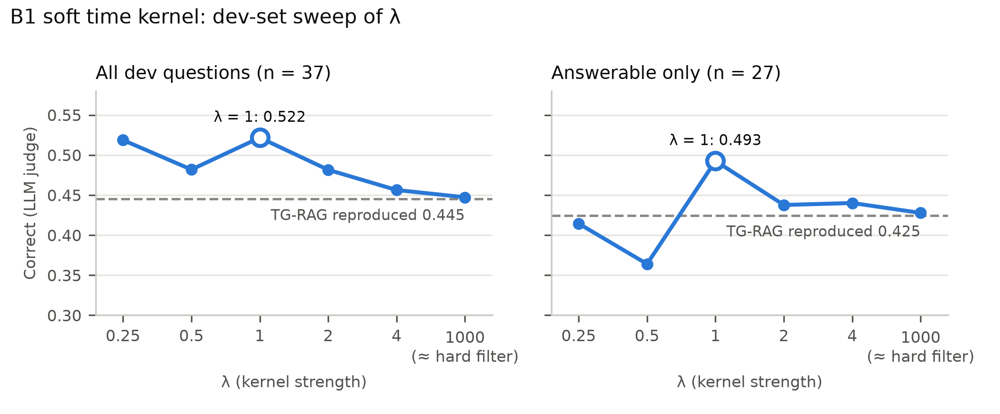

# Soft Temporal Kernels and Hybrid Lexical Seeding for Graph Retrieval in Time-Sensitive Financial QA

A soft, question-aware time weight for temporal graph retrieval, evaluated on earnings-call question answering under a pre-registered protocol.

**Project website:** https://shashvath11.github.io/Soft-Temporal-Kernel-Graph-Retrieval/  ·  **Paper:** [`paper/`](paper/)  ·  **Author:** Shashvath M (M.Tech, Amrita School of Computing, Coimbatore)

---

## The problem

Questions about company results name a period: *"What was EOG Resources' free cash flow in 2021-Q4?"*. Temporal graph retrieval ([TG-RAG](https://arxiv.org/abs/2510.13590)) stores every extracted fact with a timestamp and keeps a fact **only if its timestamp lies inside the asked period**. The timestamps are written by a language model while the graph is built. In our graph, **832 of 8,408 facts (9.9 %)** have a timestamp that is not even a valid calendar form ("2023 QQ3", "Q1 2023", "LAST YEAR"), and a fact one quarter away is dropped even when nothing from the exact quarter exists.

## The idea

Replace the 0/1 filter with a **soft temporal kernel** over a year → quarter → month → day tree:

$$\kappa(\tau) = \max_{t \in T_q} \exp\big(-\lambda\, d_H(\tau, t)\big), \qquad \text{keep } f \text{ if } \kappa(\tau_f) \ge \kappa_{\min}$$

where $d_H$ counts tree steps between a fact's timestamp and the asked period (0 inside the period, 2 for a neighbouring quarter of the same year, 4 across a year boundary). As $\lambda \to \infty$ the kernel becomes the original filter, so TG-RAG is a special case.

| | Contribution |
|---|---|
| **N1** | Soft temporal kernel with one parameter, containing the hard filter as a limit |
| **N2** | The kernel in seed selection, in the personalized-PageRank walk and in evidence scoring, against a question-independent decay (DyG-RAG-style) |
| **N3** | Deterministic timestamp-noise protocol: shift 10/20/30 % of stored timestamps by one quarter |
| **S1** | Time-partitioned hybrid BM25 + dense seeding with Reciprocal Rank Fusion |

## Architecture



TG-RAG's released code is **not modified**: `softtime` replaces its retrieval function at run time, so every compared method shares the same graph, question parser, answer prompt and models.

## Results (152 test questions, settings locked on 37 dev questions)

| Method | Correct (all) | Answerable | Unanswerable | Δ all vs TG-RAG [95 % CI] |
|---|---|---|---|---|
| TG-RAG, reproduced (hard filter) | 0.599 | 0.540 | 0.792 | – |
| Naive RAG | 0.548 | 0.426 | 0.944 | −0.051 [−0.126, +0.025] |
| **Soft kernel, λ = 1 (B1)** | **0.603** | **0.554** | 0.764 | +0.004 [−0.049, +0.059] |
| Soft kernel + walk (B12) | 0.605 | 0.555 | 0.764 | +0.005 [−0.050, +0.069] |
| Question-independent decay (B1QI) | 0.605 | 0.547 | 0.792 | +0.006 [−0.049, +0.064] |
| Hybrid seeding, hard filter (C) | 0.561 | 0.468 | 0.861 | −0.038 [−0.094, +0.020] |
| B12 + hybrid seeding (BC) | 0.626 | 0.522 | 0.958 | +0.026 [−0.039, +0.094] |

**What this means, honestly:**
- The pre-registered main claim (soft kernel beats TG-RAG) is **not supported** on the test set; the +0.077 gain seen on the dev set did not carry over.
- The kernel changes the retrieved evidence on 110 of 116 answerable questions. It helps multi-period questions and hurts single-period, multi-company ones, and the effects cancel.
- **Robustness:** as stored timestamps get noisier, TG-RAG declines and the soft kernel does not. At 30 % noise: 0.627 vs 0.566, Δ +0.061 [+0.005, +0.120]. This is significant on its own but is one of six robustness tests and does not survive a Bonferroni correction, so we report it as a trend.

| Robustness to wrong timestamps | Correct by question type |
|---|---|
|  |  |

Dev-set λ sweep: 

Full tables: [`results/main_table.md`](results/main_table.md), [`results/ablation_table.md`](results/ablation_table.md), [`results/robustness_table.md`](results/robustness_table.md), [`results/seed_analysis.md`](results/seed_analysis.md). The command behind every number: [`results/SUMMARY.md`](results/SUMMARY.md).

## Key features

- Drop-in retrieval for TG-RAG with six variants (`tgrag`, `B1`, `B12`, `B1QI`, `C`, `BC`) and a naive-RAG baseline
- Reproduction check: our re-implementation selects the same evidence as the released code on 36 of 37 dev questions
- Element-level LLM judge (Correct / Refusal / Incorrect), ROUGE-L, token F1, answerable/unanswerable split, paired bootstrap
- Resumable runs, cached model calls (temperature 0), and a record of every candidate fact with its timestamp and weight
- Proof-of-concept demo that prints both systems' evidence and answers side by side
- 24 unit tests

## Installation

Requires Python 3.12 (tested on Windows 11, no GPU) and one [OpenRouter](https://openrouter.ai) API key.

```bash
git clone https://github.com/Shashvath11/Soft-Temporal-Kernel-Graph-Retrieval.git
cd Soft-Temporal-Kernel-Graph-Retrieval

# TG-RAG is not included (its release has no licence file); fetch it at the tested commit
git clone https://github.com/hanjiale/Temporal-GraphRAG.git third_party/TG-RAG
git -C third_party/TG-RAG checkout 350f5163f2f6a56700fd20f20684d83aabbe44d7

conda create -n softtime python=3.12 -y && conda activate softtime
pip install -r requirements.txt
cp .env.example .env        # then put your OpenRouter key in .env
```

Set the two model lines in `third_party/TG-RAG/tgrag/configs/config.yaml` as described in [`configs/tgrag_config_changes.md`](configs/tgrag_config_changes.md). To use a TG-RAG checkout elsewhere, set `TGRAG_HOME` to its path.

## How to run and reproduce

```bash
# 0. tests (no API calls)
python -m pytest -q tests

# 1. data: ECT-QA (https://huggingface.co/datasets/austinmyc/ECT-QA) is shipped in the TG-RAG checkout
cp -r third_party/TG-RAG/ect-qa ./ect-qa
python scripts/make_subset.py --companies 6          # 6 companies, 37 dev / 152 test questions (seed 42)

# 2. build the temporal graph once (paid model calls; graph + dev runs together cost about USD 1.6)
python scripts/or_run.py third_party/TG-RAG/build_graph.py --output_dir ./graph_subset \
    --corpus_path ect-qa/subset/base_subset.jsonl.gz --num_docs 96

# 3. answer the test questions with one variant (repeat per variant; see scripts/run_test_suite.bat)
python scripts/run_ectqa.py --working_dir graph_subset --questions ect-qa/subset/test.jsonl \
    --variant B1 --lam 1 --out runs/test_B1_lam1.jsonl

# 4. judge, analyse, tables and figures
python scripts/judge.py runs/test_*.jsonl
python scripts/analyze.py runs/test_tgrag.judged.jsonl runs/test_B1_lam1.judged.jsonl --reference tgrag --out results/analysis/results_test
python scripts/make_tables.py && python scripts/make_figures.py

# demo: one question, both systems, every candidate fact with its timestamp and weight
python scripts/demo_compare.py --qid base-6
```

Locked settings (chosen on dev, never tuned on test): λ = 1, κ_min = 0.05, top-k = 20 chunks, 60 candidate relations, 12,000-token context, PageRank damping 0.85, RRF k = 60. Seeds: split 42, noise 13, bootstrap 0. See [`configs/settings.yaml`](configs/settings.yaml).

The run files (model answers with retrieved transcript text) and the built graph are not in the repository because they contain dataset text; they are available from the author on request.

## Folder structure

```
├── src/softtime/          # the method: soft_time.py (tree distance, kernel, noise), retriever.py (variants), openrouter.py, naive_index.py
├── scripts/               # one script per job: subset, runs, judge, analysis, tables, figures, demo, hand checks
├── tests/                 # 24 unit tests
├── configs/               # locked settings and the two TG-RAG config edits
├── results/               # tables (.md/.csv), analysis outputs, figures, per-question analysis, SUMMARY.md
├── paper/                 # IEEE conference paper and extended version (LaTeX + PDF)
├── docs/                  # project website (GitHub Pages)
└── third_party/           # where TG-RAG is cloned (not tracked)
```

## Tech stack

Python 3.12 · NetworkX (personalized PageRank) · nano-vectordb · rank-bm25 · NumPy · tiktoken · OpenAI SDK via OpenRouter (gemini-2.5-flash-lite for graph building, text-embedding-3-small, gpt-4o-mini for answering and judging) · matplotlib · pytest · LaTeX

## Citation

```bibtex
@misc{shashvath2026softtemporal,
  author = {Shashvath M},
  title  = {Soft Temporal Kernels and Hybrid Lexical Seeding for Graph Retrieval in Time-Sensitive Financial QA},
  year   = {2026},
  note   = {M.Tech project, Amrita School of Computing, Coimbatore},
  url    = {https://github.com/Shashvath11/Soft-Temporal-Kernel-Graph-Retrieval}
}
```

This work builds on TG-RAG; please also cite: J. Han et al., "RAG Meets Temporal Graphs: Time-Sensitive Modeling and Retrieval for Evolving Knowledge," arXiv:2510.13590, 2025.

## License

The code in this repository is released under the [MIT License](LICENSE). TG-RAG and the ECT-QA dataset are third-party works under their own terms and are not redistributed here.

## Author

**Shashvath M** · M.Tech (Artificial Intelligence), Amrita School of Computing, Coimbatore · supervised by Dr. Ramraj T · GitHub: [Shashvath11](https://github.com/Shashvath11)
